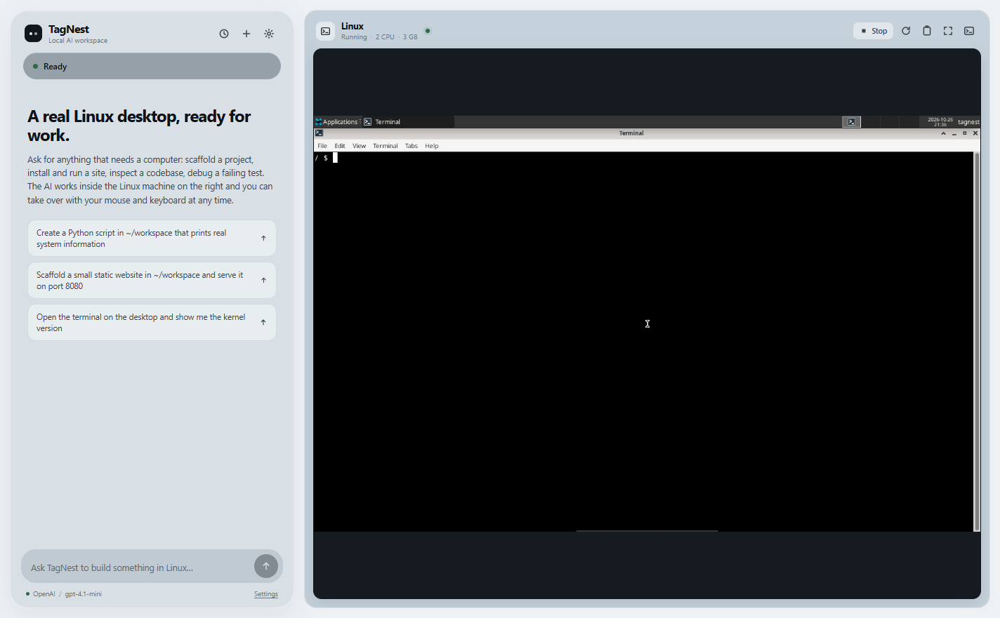
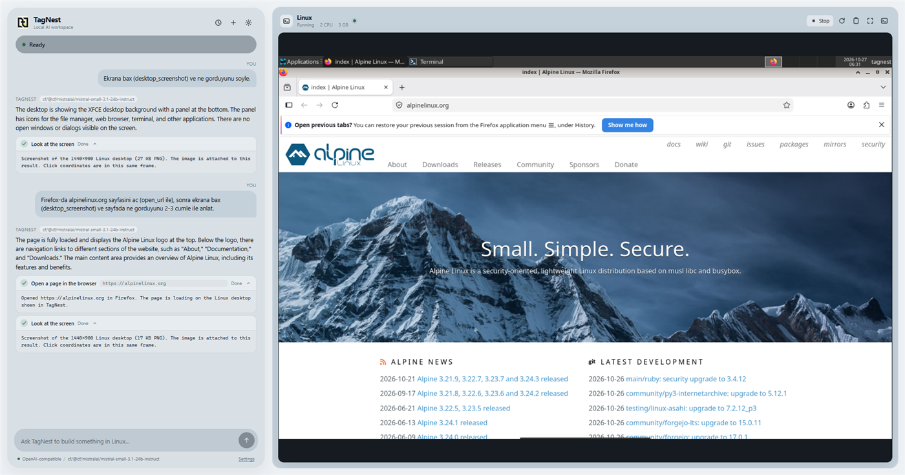

# TagNest

**A local-first AI workspace with a real Linux desktop inside it.**

[](https://github.com/Tagiyevff/TagNest/actions/workflows/ci.yml)
[](https://github.com/Tagiyevff/TagNest/releases/latest)
[](LICENSE)
[](README.md#requirements)

TagNest is an open-source desktop app for Windows 10/11. On the left, you talk to an AI agent.
On the right is a real Alpine Linux + XFCE desktop running locally in QEMU, streamed into the
window with noVNC. The agent can run commands, read and write files, start servers and control the
desktop with the mouse and keyboard — and you can take over at any moment with your own mouse and
keyboard.

There is no TagNest account, no TagNest server and no subscription. The Linux machine is yours,
on your computer, stored on your disk.



> Screenshot captured from the real Electron window: an agent task on the left and the actual XFCE
> desktop on the right. See [docs/VALIDATION.md](docs/VALIDATION.md) for the checks that were
> actually executed, with their output and the things that were not tested.

## Install (Windows)

1. **Download the installer** from [Releases](https://github.com/Tagiyevff/TagNest/releases/latest):
   `TagNest-<version>-x64.exe`. Builds are produced and attached by the
   [Release workflow](.github/workflows/release.yml), so every binary comes from a tagged commit.
2. **Install QEMU on the host** — TagNest drives a real VM and does not redistribute QEMU:
   ```powershell
   winget install SoftwareFreedomConservancy.QEMU
   ```
3. **Run TagNest.** The first launch downloads the Alpine base image, provisions the desktop and
   installs Firefox inside the guest (a few minutes, ≈250 MB of downloads). Later launches boot
   straight to the desktop; your Linux files stay in `%APPDATA%\TagNest`.
4. **Add a model** in Settings (gear icon): paste an OpenAI / Anthropic / Gemini / OpenRouter key,
   point it at a custom OpenAI-compatible endpoint, or select **Ollama (local)** for fully local
   inference. Keys are encrypted with the OS credential store and never leave your machine except
   as the request to the provider you chose.

The installer is **unsigned**, so Windows SmartScreen will show "unrecognised app" on first run.
Hardware virtualization (WHPX) is strongly recommended; without it TagNest explains the problem and
offers the slow software-emulation path.

Building from source instead: see [Quick start (development)](#quick-start-development) and
[docs/RELEASING.md](docs/RELEASING.md).

## Status

Early release (`0.1.0`). The Linux runtime, embedded desktop, agent tool loop, approvals and
settings are implemented and were exercised against a real VM. Typecheck, lint, 36 unit tests, the
production build and the real-VM smoke test pass. Provider adapters were tested against local mocks
of their real HTTP APIs, and the OpenAI-compatible path was additionally driven end to end against
a local router that forwards to a real hosted model — tool calls, file creation and read-back in the
guest all worked. The full agent loop — including web search, page fetch and opening a page in the
guest browser — was tested against a mock OpenAI-compatible server driving real guest commands and
real internet requests. See [docs/VALIDATION.md](docs/VALIDATION.md) for the exact results, including
what was **not** verified.

## What works

- Split-panel UI: chat (≈29% width) + live Linux desktop (≈71%), responsive and independently scrollable.
- A real Alpine Linux 3.24 VM (QEMU, WHPX acceleration on Windows) provisioned automatically on
  first launch — no manual Linux install, no VM setup.
- Persistent qcow2 overlay disk: files written in Linux survive app and VM restarts.
- Real internet in the guest: it shares the computer's own connection through QEMU user-mode
  networking, so downloads, package installs and web pages behave like on the host.
- A real browser in the guest: Firefox is installed automatically on the first start after
  provisioning (one `apk` install, about 90 MB) and runs on the visible desktop.
- Agent internet tools: `web_search` (DuckDuckGo), `web_fetch` (URL → readable text) and
  `open_url` (opens the page as a tab in the Firefox window you already have, so you watch it load
  in the right-hand panel).
- A structured system prompt (`src/main/agent/prompts.ts`) sent to every provider: who the agent is,
  the real guest facts, the full tool inventory, how to verify its own work and how to reply — so a
  fresh model starts useful instead of guessing.
- Embedded TigerVNC → WebSocket → noVNC display with mouse, keyboard, clipboard paste/copy and
  viewport scaling.
- **The agent can see the screen.** `desktop_screenshot` captures the real guest desktop and hands
  the PNG to a vision-capable model, so it can read a page, find a button and click it — verified
  end to end against a live model (see [docs/VALIDATION.md](docs/VALIDATION.md)).
- Agent tools that act on real state: shell commands, SFTP file read/write/edit/list/search,
  system inspection, background processes, and `xdotool` desktop control — move, single/double/right
  click, wheel scroll, type, key chords, list and focus windows, launch apps. The AI cursor is drawn
  over the desktop so every movement is visible.
- A visible AI cursor and activity indicator over the desktop.
- Explicit approval gates for `sudo`, package installs, service changes, downloads piped to a
  shell, GitHub pushes, recursive deletion and other high-impact commands.
- Cancellation for in-flight model calls and guest commands; aborting kills the guest process group,
  not just the SSH channel.
- Model providers: OpenAI, Anthropic, Google Gemini, OpenRouter, Ollama (local) and any custom
  OpenAI-compatible endpoint. Keys are encrypted with the OS credential store (DPAPI on Windows).
- Local conversation history and task/tool logs; conversation JSON is stored in the app data dir.
- English and Azerbaijani UI.
- Configurable VM memory/CPU count/disk size and automatic startup.

## Requirements

| | |
|---|---|
| OS | Windows 10/11 x64 (primary target). macOS/Linux run the UI and a slower TCG VM for development. |
| RAM | 8 GB total recommended; the VM defaults to 3 GB and is configurable (2–8 GB). |
| Disk | ~250 MB for the base image + ~1–2 GB for the installed desktop + your files, in the 20 GB (sparse) workspace disk. |
| CPU | Hardware virtualization (WHPX) strongly recommended. Software emulation (TCG) is very slow. |
| QEMU | Required on the host. Install with `winget install SoftwareFreedomConservancy.QEMU` (QEMU 11 tested), or set `TAGNEST_QEMU` to the executable. |
| Internet | First launch downloads the pinned Alpine image and lets the guest install the desktop and Firefox (≈150 MB + ≈90 MB). After that the guest uses your connection like any other app, and model calls need the network (unless you use Ollama). |

QEMU is intentionally **not** committed to this repository; it is GPL software with its own
distribution requirements. If you ship installers, see [docs/LICENSING.md](docs/LICENSING.md).

## Quick start (development)

```bash
npm install
npm run dev
```

The Electron window opens. On first launch TagNest:

1. checks for QEMU and probes WHPX,
2. downloads the official Alpine 3.24 cloud image (≈150 MB) and verifies its SHA-512,
3. creates a 20 GB sparse qcow2 overlay,
4. boots the VM with cloud-init (seed served from the app over QEMU's user-mode network),
5. installs XFCE, TigerVNC, xdotool and an SSH key for the agent,
6. starts Xvnc + XFCE and attaches the display to the right-hand panel.

Provisioning takes a few minutes the first time. Later launches boot straight to the desktop.

Add an API key in **Settings** (gear icon), pick a model, then ask for something:

- "Create a small Express app in `~/workspace/demo` and start it on port 3000."
- "Search the web for the Alpine Linux wiki and open the result in the browser."
- "Open the terminal on the desktop and show the kernel version."
- "Find failing tests in `~/workspace/app` and fix them."

Or use a local model: install [Ollama](https://ollama.com), pull a model, select **Ollama (local)**
in Settings and set the model name. Prompts and tool results then stay on your machine.

## How it works

```
┌───────────────────────── Electron window ─────────────────────────┐
│ Renderer (React)                                                  │
│   ChatPanel                 LinuxPanel -> noVNC canvas            │
│        │ IPC (contextBridge, validated)      │ WebSocket          │
│ ───────┼─────────────────────────────────────┼──────────────────  │
│ Main process                                 │                    │
│   AgentRuntime ── providers (OpenAI, Anthropic, Gemini, …)        │
│        │ tool executor                       │                    │
│        │ SSH (exec + SFTP)                   │ token-gated proxy  │
│        ▼                                     ▼                    │
│   QEMU (WHPX, pc/qemu64)  ── hostfwd:22──►  guest sshd           │
│        │                     hostfwd:5901──►  Xvnc :1 + XFCE     │
│        └─ qcow2 overlay (persistent)          xdotool, files      │
└───────────────────────────────────────────────────────────────────┘
```

- The renderer has no Node access. `contextIsolation: true`, `sandbox: true`, a Content-Security
  Policy, navigations blocked, and a narrow typed API in `src/preload`.
- QEMU, SSH, VNC and filesystem control live only in the main process.
- The agent loop is in `src/main/agent/agent.ts`; providers implement one `complete()` interface.
- The guest is a normal QEMU VM. The host filesystem is not mounted into it, and QEMU's user-mode
  network is the only network path. SSH/VNC are forwarded to random loopback ports only.
- The VNC WebSocket proxy requires a per-session random token. The guest's Xvnc accepts unauthenticated
  RFB, but is reachable only through that loopback forward.



> The agent took a screenshot, opened `alpinelinux.org` in the existing Firefox window, looked again
> and described the real page. Vision needs a model that accepts images (see Providers).

More detail: [docs/ARCHITECTURE.md](docs/ARCHITECTURE.md).

## Providers

| Provider | Endpoint | Auth | Privacy |
|---|---|---|---|
| OpenAI | `https://api.openai.com/v1` Chat Completions | API key | prompts + tool results leave the machine |
| Anthropic | `https://api.anthropic.com/v1/messages` | API key | same |
| Gemini | `generativelanguage.googleapis.com` `generateContent` | API key | same |
| OpenRouter | `https://openrouter.ai/api/v1` | API key | same |
| Ollama | `http://127.0.0.1:11434/v1` | none | stays on your machine |
| Custom | your OpenAI-compatible base URL | optional | depends on the endpoint |

There is no invented fallback: if a provider is selected without a key or the request fails, the
error appears in the chat and no command is run. Keys never go to the renderer and are never logged.

Local OpenAI-compatible relays and routers are supported: the response body is read tolerantly, so a
router that appends an SSE `data: [DONE]` terminator after a non-streaming JSON reply still works.
If an endpoint answers with something that is not JSON at all, the chat reports the HTTP status,
content type and the first bytes instead of a raw parser error.

## Building and packaging

```bash
npm run build        # typecheck-free production bundle (electron-vite)
npm run typecheck
npm test
npm run lint
npm run package:win  # electron-builder NSIS installer in release/
```

The app icon and installer icon come from `build/icon.png` (1024×1024, generated from the TagNest
logo crop); the sidebar logo is `src/renderer/src/assets/logo.png`.

Native dependency rebuilding is disabled in the packaging config: ssh2's optional `cpu-features`
addon is not needed (ssh2 falls back to pure JavaScript), and its vendored gyp files are incomplete
in this environment. The packaged app includes the main/preload/renderer bundles and `resources/`
but **not** QEMU or a guest disk image.

Optional: bundle the Linux base image into the installer instead of downloading on first launch:

```bash
npm run provision:linux   # downloads + verifies resources/linux/alpine-*.qcow2
npm run package:win
```

`resources/linux/*.qcow2` is git-ignored. The VM's overlay always lives in the user data directory,
so upgrading or replacing the base image never deletes user files.

## Data locations

Windows: `%APPDATA%\TagNest`

```
settings.json          preferences (no secrets)
secrets.json           DPAPI-encrypted provider keys
conversations/*.json   chat history and tool results
linux/base/            verified Alpine base image
linux/disk/workspace.qcow2   persistent guest disk (your files)
linux/ssh/             agent SSH keypair
linux/logs/            QEMU serial console + stderr
logs/                  app log (redacted)
```

Delete `linux/disk/workspace.qcow2` only if you mean to destroy the Linux workspace.

## Testing

```bash
npm test             # unit tests: providers against mock HTTP APIs, policy, paths, storage, web helpers
npm run typecheck
npm run lint
npm run smoke:linux  # boots the real VM and verifies the runtime end to end
npm run smoke:agent  # agent loop against a scripted OpenAI-compatible endpoint: approvals, file
                     # tools, web_search / web_fetch / open_url against the real guest
```

`smoke:linux` downloads/provisions on first use (`TAGNEST_SMOKE_CLEAN=1` to force a fresh
workspace). To reuse an existing workspace instead of provisioning another one:

```bash
# Windows PowerShell
$env:TAGNEST_SMOKE_DIR="$env:APPDATA\TagNest"; npm run smoke:linux
```

It runs real commands, writes/reads a file over SFTP, checks the 1440×900 X display and moves the
real guest mouse with `xdotool`, completes an RFB greeting through the token bridge, cancels a
running command (and checks it returns quickly without printing), restarts the VM, verifies the
file persisted and checks that no Windows host paths are mounted. The recorded run: **PASS**,
94.9 s total, 30.3 s restart, 425 ms cancellation. See [docs/VALIDATION.md](docs/VALIDATION.md).

## Known limitations

- **First launch is not instant.** No prebuilt TagNest image is committed or hosted in this
  repository (it would be hundreds of MB to over a GB). The app downloads the pinned official
  Alpine cloud image, boots it, lets cloud-init apply the seed, and installs XFCE/TigerVNC inside
  the guest. On this machine that took about six minutes on a cold workspace; later boots took
  about 30 seconds. The build supports bundling a prebuilt base image in the installer
  (`resources/linux/*.qcow2` via `npm run provision:linux`), which a release should do; that path
  was not built or tested here.
- **Windows/WHPX first.** Without WHPX the VM falls back to TCG. The pinned Alpine 6.18 kernel
  panicked under TCG on the development machine, so software emulation is not a reliable fallback.
  TagNest reports the problem and the serial log instead of pretending it works. Enabling Windows
  Hypervisor Platform is the supported fix.
- QEMU is expected on the host; the repo does not redistribute QEMU binaries. An installer has to
  ship them separately or install QEMU as a prerequisite.
- The NSIS installer builds (`release/TagNest-0.1.0-x64.exe`, ≈117 MB) and the packaged
  `win-unpacked` app was launched and verified with the real VM. The installer is built by CI but
  install/uninstall was not exercised on a clean Windows machine. It is unsigned, so Windows
  SmartScreen will warn.
- The desktop is scaled to the panel; dynamic guest resolution changes are not implemented. The
  guest screen is fixed at 1440×900 (VNC viewport scaling keeps it usable).
- **Vision needs a vision-capable model.** `desktop_screenshot` sends a real PNG to the provider, so
  the selected model must accept images (e.g. a multimodal OpenAI/Anthropic/Gemini model, or a
  vision model on your local router). A text-only model answers without seeing the image or rejects
  the request; that error is shown in the chat. There is no DOM/page-source tool — the screenshot is
  what the agent sees — and very large screenshots are capped at 4 MB.
- Firefox is installed automatically the first time a workspace boots with the updated runtime;
  that step needs internet access and adds about 90 MB to the guest disk. Browser *automation*
  (reading page pixels, driving the DOM) is not implemented — the agent uses `web_fetch`/
  `web_search` for content and can only show pages to you with `open_url`.
- Hosted provider calls were not exercised with live keys in this environment; see VALIDATION.
- Clipboard transfer and proportional guest-resolution changes are implemented but were not
  exercised in the validation run.
- Guest isolation is strong (a VM) but not a certified security boundary. See SECURITY.
- Azerbaijani translations are complete for UI strings but not professionally reviewed.

## License

MIT for TagNest's own code. QEMU, Alpine, XFCE, TigerVNC and other components keep their own
licenses — see [LICENSE](LICENSE) and [docs/LICENSING.md](docs/LICENSING.md).
