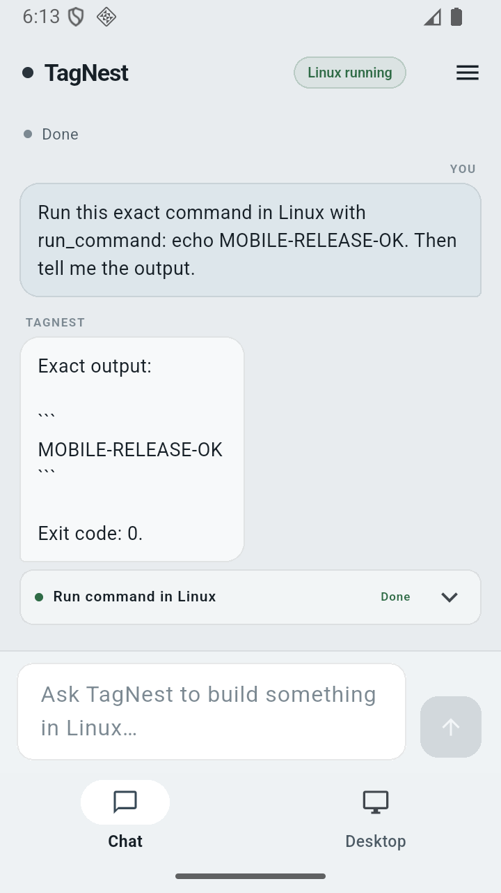
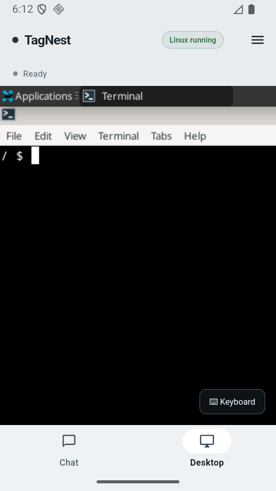

# TagNest Mobile

The Android companion for [TagNest](../README.md). It is a real Flutter app, not a web wrapper:
chat with the same agent that runs inside the Linux VM on your computer, approve dangerous
commands from the phone, and open the live Linux desktop in an embedded noVNC view.

The computer still does the work. The phone is a remote control for **your** TagNest instance; no
TagNest account or cloud workspace is involved.

| Chat and tool results | The live Linux desktop |
|---|---|
|  |  |

Both screenshots were captured from the release APK running against a real TagNest VM.

## What it does

- **Pair once.** In TagNest on the computer: Settings → Phone access → start it, then enter the
  computer address and the 6-digit code in the app. The code expires after 15 minutes and each
  phone gets its own revocable token.
- **Chat and watch.** The task bar shows planning/running/waiting/stopped states, tool calls expand
  to their real output and exit code, and **Stop** cancels the running task.
- **Approve high-impact commands.** The approval card shows the exact command; allow once or deny.
  The agent cannot bypass the desktop's approval policy from the phone.
- **Live desktop.** The Desktop tab embeds the real guest screen through noVNC. Taps and drags are
  real mouse events; the keyboard button opens a text field that sends real key events to the
  focused guest window. Pinch/scroll and the desktop's own scaling keep it usable on a phone.
- **Task history.** Open the menu to switch between conversations, start a new task, or forget the
  phone (which revokes its token on the computer).
- **Designed to match TagNest.** The same restrained gray-blue surfaces, typography and spacing as
  the desktop app.

## Connect from anywhere

TagNest has three access modes in **Settings → Phone access**:

| Mode | Use it for | Address |
|---|---|---|
| **Cloudflare quick tunnel** (default) | Away from home, no account or router setup | `https://….trycloudflare.com` |
| **Home network** | Same Wi-Fi, lowest latency | `http://<computer-LAN-IP>:47821` |
| **Custom URL** | A stable address you already own (named Cloudflare Tunnel, reverse proxy, Tailscale Funnel) | whatever your proxy serves |

The quick tunnel is created by a pinned `cloudflared.exe` that TagNest downloads and checksum-verifies
on first use. It only exposes the remote server, which requires the pairing token; the VNC port,
SSH port and agent stay on loopback.

**The quick-tunnel address changes whenever TagNest or the computer restarts.** That is how
Cloudflare quick tunnels work. While TagNest is running it is stable, and closing the window does not
stop it — the app stays in the system tray so the phone keeps working (the tray menu has **Show
TagNest** and **Quit TagNest**). For a permanent address across restarts, use a named Cloudflare
Tunnel or another stable reverse proxy and select **Custom URL**.

The app also blocks system sleep while phone access is running. A laptop lid can still suspend the
machine depending on its power plan, so keep the lid open or change that plan if you need long
sessions.

## Build

Prerequisites: Flutter 3.41+ with the Android SDK, and Java 17.

```bash
cd mobile
flutter pub get
flutter analyze
flutter test
flutter build apk --release
```

The APK lands at `build/app/outputs/flutter-apk/app-release.apk`. The release workflow builds and
attaches it automatically; CI runs analyze, tests and a build on every push.

### Release signing

Release builds are signed with a key that is **not in this repository**. Locally, create
`mobile/android/key.properties` and the keystore it points to:

```properties
storePassword=…
keyPassword=…
keyAlias=tagnest
storeFile=tagnest-release.jks
```

`mobile/android/key.properties` and `*.jks` are git-ignored. In CI the same files are recreated from
the repository secrets `ANDROID_KEYSTORE_BASE64`, `ANDROID_KEYSTORE_PASSWORD`, `ANDROID_KEY_ALIAS`
and `ANDROID_KEY_PASSWORD`. Without them a debug-signed APK is still produced, but Android will
refuse to install it over an APK signed with the release key (uninstall first).

Back up the keystore and its passwords: losing them means future APKs cannot update an installed
release. The app is distributed by sideloading from GitHub Releases; it is not on Google Play.

## Project layout

```text
lib/api.dart                 HTTP client, pairing, session storage, JSON models
lib/screens/connect_screen.dart  address + pairing code
lib/screens/home_screen.dart     chat, approvals, tasks, embedded desktop
lib/theme.dart               shared visual language
test/widget_test.dart        pairing screen and URL normalization tests
```

The server contract is in [`src/main/remote/`](../src/main/remote): `/api/health`, `/api/pair`,
`/api/state`, `/api/send`, `/api/cancel`, `/api/approve`, `/api/retry`, conversation endpoints,
`/desktop` and the authenticated `/vnc` WebSocket.

## Security notes

- The phone stores its device token in Android app-private preferences. **Forget this phone** calls
  the computer's revoke endpoint and clears the local token.
- Pairing is rate-limited and the code is short-lived. Treat the address + code like a password.
- The tunnel exposes only the authenticated remote surface; it does not expose SSH, VNC directly or
  the QEMU monitor.
- A quick-tunnel URL is public in the sense that anyone who learns it reaches the login/pairing
  page. Without a paired token the API returns 401. For a stable public URL, put your own proxy in
  front and keep the token private.

## Known limitations

- Android only; the Flutter project has no iOS target configured.
- The desktop is streamed; heavy motion (video, animations) is limited by the VNC link.
- File drag-and-drop and clipboard sync are desktop-only for now. Typing, pointer input and scrolling
  work.
- The app has no offline mode: it needs a route to the computer (LAN or tunnel).
